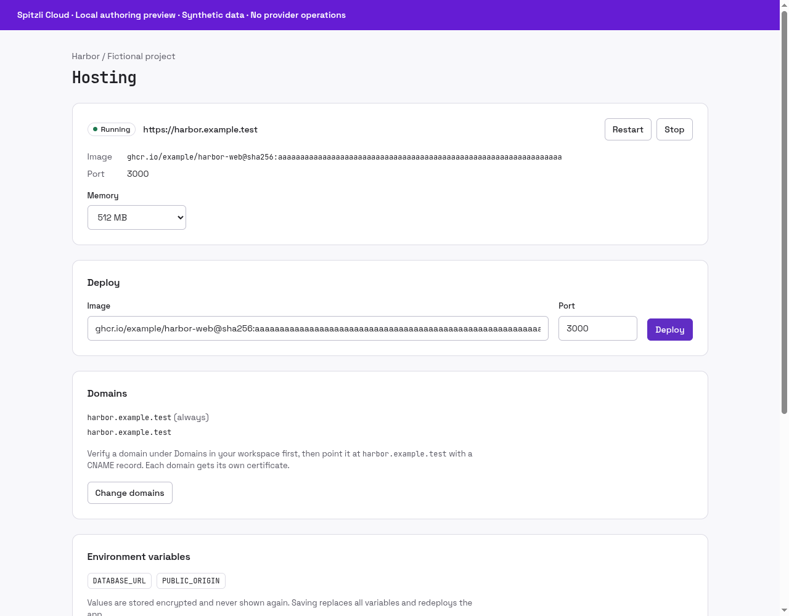

# Hosting


Run an application from a container image and manage its existing deployment in your project.

## What you can do

View status, redeploy an image, change memory, manage environment-variable names and verified domains, start/stop/restart, inspect recent logs and explicitly delete an app.

## Setup and access

Requires an operator-installed native runtime, project Hosting grants, an enrolled cluster and the workloads service. Supply a container image and application port; production policy may require an immutable image digest.

## Data and security

Core places each application in its project namespace. Environment values are sealed at rest and the UI lists names. Stopping scales the application to zero; deletion is a separate operation. Logs can contain application data.

## Status and limits

Beta. Memory options are 128 MiB–2 GiB, up to 10 verified custom domains, and recent logs are limited to 100 lines / 24 KiB. Git builds and persistent-volume management are not provided by this plugin.

Catalog publication does not activate the plugin, enable public signup or grant
access to any customer resource. A new presentation release must use a new version;
previously signed releases and their assets stay immutable.

## Gallery

Actual Hosting resource panel; synthetic project, app and logs. No cluster operations.



## Catalog source

`.tabularium` is the complete catalog-refresh source. It retains the immutable
runtime image and full protocol/access contract of the currently released
`0.1.0` and adds the prepared presentation assets. Refresh it only from a
reviewed immutable source commit. This does not replace signed release assets
or activate the runtime.

## Technical reference

The retained implementation notes below include platform integration procedures.
Commands referring to Core, `tools/` or `apps/console` require the [platform source
checkout](https://github.com/spitzli/webdock); they are not standalone setup steps.

Apps as a Webdock plugin. A project runs an app from a container image with a port, a memory size (128 MB to 2 GB) and environment variables. Customers can redeploy with a new image, edit variables (stored AES-256-GCM sealed; only names are ever shown), start, stop and restart, read the recent log lines (the last 100, up to 24 KiB), and delete the app. Features: `create-apps` (create and delete) and `resize-apps` (memory), each with its own access mode.

Placement goes through `plugin.workloads`: each app is one unit of a Secret (its environment), a Deployment, a Service and a Traefik route on `<name>-<id>.<domain>`. Core pins the unit to the project's namespace and the cluster's agent applies it and reports readiness, pod problems and recent logs, which `apps.view` and `apps.logs` read back. Stop scales to zero, restart rolls the pods. Each app reserves CPU in step with its memory (a quarter millicore per MiB, at least 50m, at most one core) and counts against the customer's plan; a new image takes over once its port accepts connections. With `issuer` set, cert-manager issues each app a certificate and the route serves HTTPS. Locally the apps run on the dev k3s and answer on `https://<name>-<id>.apps.localhost:55481`, issued by the local CA (`.dev-local/ca/ca.crt`). Image tags are accepted locally; `requireDigest` makes production installs accept digest-pinned images only. Apps also answer on up to 10 of the customer's own domains (`apps.domains`), each in the route and the certificate; Core accepts only domains the customer verified with a TXT record. Builds from Git and volumes come later.

```sh
cargo test --manifest-path Cargo.toml
# Disposable loopback PostgreSQL for plugin storage; Core and the cluster are stood in for:
SPITZLI_HOSTING_PLUGIN_TEST_ADMIN_URL=postgres://… \
  cargo test --manifest-path Cargo.toml -- --include-ignored
```
